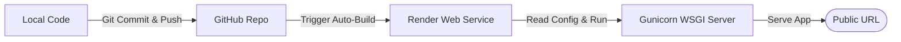

# Deployment Guide: TaskFlow Flask + SQLite App on Render

This guide provides a step-by-step walkthrough to deploy your **TaskFlow – Task Management System** online using **Render** and **GitHub**.

---

## 1. Concepts & Workflow

Before running commands, it is helpful to understand how these parts fit together:



1. **GitHub Integration**: You will push your code to a private or public GitHub repository. Render will link to this repository and automatically deploy updates whenever you push changes to your `main` branch.
2. **Production Startup (WSGI)**: In development, you ran `python main.py`, which starts Flask's built-in development server. In production, we use **Gunicorn** (Green Unicorn).
   * **Why Gunicorn?** The built-in Flask server is not designed for production; it is single-threaded, does not handle concurrency well, and is not optimized for security or stability. Gunicorn is a WSGI (Web Server Gateway Interface) HTTP server that manages multiple worker processes to handle concurrent users efficiently and securely.
3. **SQLite Persistence**: Render services run on ephemeral disks by default. This means any database edits (like adding new assignments) are deleted when the server sleeps or restarts. To prevent this, we configure a **Render Persistent Volume** to store our SQLite file permanently.

---

## 2. Step 1: Push Code to GitHub

1. **Initialize Git** in your project folder (if not already done):
   ```bash
   git init
   ```
2. **Create a `.gitignore` file** in the project root to prevent committing temporary or binary files:
   Create a file named `.gitignore` and add:
   ```text
   __pycache__/
   *.pyc
   .env
   instance/
   ```
   *Note: We recommend committing your initial `database.db` file so the app starts with seeded data, or let it seed itself when it starts on Render.*
3. **Commit your files**:
   ```bash
   git add .
   git commit -m "Prepare Flask + SQLite app for Render deployment"
   ```
4. **Create a Repository on GitHub**:
   * Go to [GitHub](https://github.com/) and click **New Repository**.
   * Name your repository (e.g., `employee-allocation-system`).
   * Choose **Private** or **Public**.
   * Leave "Initialize this repository with" unchecked.
5. **Link and Push to GitHub**:
   Run the commands provided by GitHub (replace with your actual URL):
   ```bash
   git remote add origin https://github.com/YOUR_USERNAME/YOUR_REPO_NAME.git
   git branch -M main
   git push -u origin main
   ```

---

## 3. Step 2: Configure Render Web Service

1. Log in to [Render Dashboard](https://dashboard.render.com/).
2. Click **New +** and select **Web Service**.
3. Select **Build and deploy from a Git repository**.
4. Connect your GitHub account and select your repository.
5. Configure the Web Service settings:
   * **Name**: `taskflow-system` (or any unique name)
   * **Region**: Choose the region closest to you or your users.
   * **Branch**: `main`
   * **Language**: `Python`
   * **Build Command**: 
     ```bash
     pip install -r requirements.txt
     ```
   * **Start Command**: 
     ```bash
     gunicorn main:app --bind 0.0.0.0:$PORT
     ```
   * **Instance Type**: Select **Free** (or Starter).

---

## 4. Step 3: Configure SQLite Persistence (Crucial)

Since SQLite is a file-based database, we must attach a **Persistent Volume** so data is not lost when Render restarts the service:

1. In your Render Web Service dashboard, go to the **Disks** section in the left-hand menu.
2. Click **Add Disk** (Persistent Volume):
   * **Name**: `sqlite-db-volume`
   * **Mount Path**: `/var/data`
   * **Size**: `1 GB` (more than enough for SQLite logs and records)
3. Click **Create Disk**.
4. Go to the **Environment** section in the left-hand menu.
5. Click **Add Environment Variable** and add the following keys:
   * **`SECRET_KEY`**: Set this to a long, secure random string (e.g. `9f8e7d6c5b4a3a2b1c`).
   * **`DATABASE_PATH`**: Set this to `/var/data/database.db`.
6. Click **Save Changes**.

Render will automatically trigger a redeploy of your service. Your app will now read and write to the database located in `/var/data/database.db`, keeping all allocations safe forever!

---

## 5. Troubleshooting & Debugging Common Issues

### 1. `ModuleNotFoundError: No module named 'gunicorn'`
* **Cause**: Gunicorn is not installed on the server.
* **Fix**: Ensure `requirements.txt` contains `gunicorn==22.0.0` (or similar version) and redeploy.

### 2. Port Binding Issues
* **Cause**: Flask is hardcoded to port `5000` but Render requires binding to a dynamically assigned port.
* **Fix**: Ensure your Start Command in Render is configured with `--bind 0.0.0.0:$PORT`. This tells Gunicorn to listen on the port assigned by Render.

### 3. Database is locked / Read-only filesystem
* **Cause**: The application is trying to write `database.db` directly inside the build directory which might have read-only permissions on some platforms, or the disk volume is not correctly mounted.
* **Fix**: Make sure your `DATABASE_PATH` environment variable is set to `/var/data/database.db` and the disk is mounted at `/var/data`.

### 4. Application Crashes on Startup (Logs Analysis)
* Go to the **Logs** tab in Render.
* If you see `SyntaxError` or Python syntax issues, verify your Python version setting in Render (you can add a `PYTHON_VERSION` environment variable with a value like `3.10.12` to force a specific version).
* If you see `sqlite3.OperationalError: unable to open database file`, double-check that the `/var/data` directory exists and has write permissions. (Render creates this directory automatically when mounting the volume).
